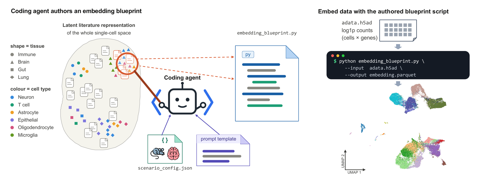

# Coding agents author interpretable single-cell embedding models from the literature

A coding agent authors a single-cell RNA-sequencing (scRNA-seq) embedding model directly
from the literature, given only a description of the biological scenario. It edits a Python
template, the **blueprint**, to curate named, literature-cited gene programs and compose
them into typed embedding axes. It uses no gene-set database, does no training, and never
sees the data. Applying a blueprint is then a deterministic, CPU-only readout that scores
each cell on the curated marker genes. Because every dimension is a named, cited gene
program, the resulting zero-shot embedding is interpretable and auditable by construction.
The axes can also be steered into structured topologies such as a developmental tree.



*Left: a coding agent edits the blueprint template to author literature-cited gene programs
and axes, without seeing the data. Right: applying the blueprint is a deterministic, CPU-only
pass that embeds an `.h5ad` into a cell-by-axis table. (Figure 1a,b of the manuscript.)*

> **Manuscript.** This repository contains the code for *"Coding agents author interpretable
> single-cell embedding models from the literature"* (Brunn et al.).
> Paper: **[link to be added]**.

> ⚠️ **Authoring blueprints uses paid LLM credits.** The agentic pipelines and the web app's
> Generate tab drive an external coding-agent CLI (currently Codex or Claude), which needs
> your own provider account, an API key or subscription, and the provider's CLI installed
> locally. Each authoring run is billed to your account. The cost scales with the model, the
> reasoning effort, the number of runs, and whether Stage B refinement is enabled.
> Reproducing the manuscript results does **not** use LLM credits, since the reproduction
> scripts run from the blueprints already committed here. The code is provided as is under
> the MIT License, without warranty, and you are solely responsible for your use of it and
> for any costs you incur.

## What's here

- **Code to reproduce the manuscript results** — the deterministic embedder, the baselines,
  the full evaluation suite (scIB benchmarking, axis faithfulness, reproducibility,
  blueprint variability, developmental-tree temporal metrics, held-out transfer, cost), and
  the two reproduction scripts (`scripts/`, `analysis/reproduce_*.sh`).
- **Agentic pipelines** — orchestrators that drive a coding agent (currently Codex or
  Claude) to author blueprints, with an optional refinement loop and literature-grounding
  checks (`analysis/`, `scripts/agentic_embedding/`, `prompt_templates/`).
- **Interactive web app** — a local-first Dash app to author, edit, apply, and explore
  blueprints on your own data (`webapp/`).

## Repository layout

| Path | Contents |
| --- | --- |
| `analysis/` | Bash orchestrators (data pipeline, authoring, reproduction). See `analysis/README.md`. |
| `scripts/` | Embedder, baselines, metrics, and plotting. |
| `configs/` | Per-dataset scenario configs + name/axis-type mappings. |
| `prompt_templates/` | Agent prompts (blueprint edit / discriminate / generate, free-form). |
| `outs/` | Shipped results: authored blueprints + metric CSVs (embeddings/plots are regenerable). |
| `models/genesets/` | Gene sets for the UCell / expiMap baselines. |
| `webapp/` | Local Dash web application. See `webapp/README.md`. |
| `tests/` | Test suite (`pytest tests/`). |

## Installation

```bash
conda env create -f environment.yml
conda activate agentic-embeddings
```

This environment covers the analysis pipeline, the baselines, and both reproduction
scripts. The web app is installed separately (`bash webapp/setup.sh`, see below).

### Coding-agent CLI (authoring only)

Authoring new blueprints additionally needs the coding-agent CLI installed on your machine,
with your own provider account. This is not required to reproduce the manuscript results or
to use the web app's Map and Explore tabs. Node.js 18+ is a prerequisite for either CLI.

- **Codex** (OpenAI): `npm install -g @openai/codex`. See [github.com/openai/codex](https://github.com/openai/codex) and the [CLI docs](https://developers.openai.com/codex/cli).
- **Claude Code** (Anthropic): `npm install -g @anthropic-ai/claude-code`. See the [setup docs](https://code.claude.com/docs/en/setup) and [github.com/anthropics/claude-code](https://github.com/anthropics/claude-code).

## Usage

### Web app

Author a blueprint from a scenario description, drop in an `.h5ad`, and explore the
embedding interactively. Everything runs locally, and your data never leaves your machine.

```bash
bash webapp/setup.sh          # one-time: creates webapp/.venv and installs deps
python -m webapp              # serves http://127.0.0.1:8050
```

The **Map** and **Explore** tabs need nothing extra. The **Generate** tab, which does the
real blueprint authoring, needs the OpenAI Codex CLI on your `PATH` plus an API key. The
full guide is in [`webapp/README.md`](webapp/README.md).

### Data pipeline

```bash
bash analysis/run_data_pipeline.sh                 # all datasets (downloads several GB)
bash analysis/run_data_pipeline.sh human_pancreas  # a single dataset
```

Writes `data/preprocessed/<dataset>_pp.h5ad` (git-ignored).

### Authoring blueprints (agentic)

The authoring workflow, its flags, and the cross-engine details are documented in
[`analysis/README.md`](analysis/README.md). A single run authors a blueprint and embeds it
onto the data:

```bash
bash analysis/agent_edit_blueprint.sh --dataset mouse_cortex     # Codex, Stage A + embed
bash analysis/agent_edit_blueprint.sh --help
```

The refinement loop (`--with-refine`), the resource-unconstrained variant (`--noref`), the
Claude orchestrator, and its isolation caveat are all covered in
[`analysis/README.md`](analysis/README.md).

## Reproducing the manuscript results

The authored blueprints and all metric CSVs are committed under `outs/`, so the results
can be reproduced **without re-running the expensive agentic authoring pipeline**. There
are two entry points.

> **Why reproduction starts from the shipped blueprints.** You can author fresh blueprints
> with the agentic pipeline (`analysis/agent_edit_blueprint.sh`), but re-authoring will not
> reproduce a shipped blueprint gene-for-gene. Authoring depends on an external language
> model whose sampling is stochastic and whose weights change between versions, so each run
> curates a somewhat different set of genes and citations. This variation is bounded and does
> not propagate to the embedding. Exact figure reproduction therefore
> consumes the committed blueprints under `outs/blueprints/` rather than re-authoring them.

### Quick (from the shipped results)

```bash
bash analysis/reproduce_figures.sh
```

Re-plots the quantitative and structural figures from the committed CSVs. These are the scIB
frontier and leaderboard tables, the blueprint-vs-free-form three-way summary, cross-run
reproducibility, resource cost, the refinement ablations, the developmental-tree temporal
panels and axis tree, the held-out transfer bars, and the authored-blueprint cards. It runs
in minutes with only the conda env, and needs no downloads or baselines. Figures land under
`outs/plots/`.

Two things need the full path below. The quick path does not build the embedding-visualization
figures (UMAP grids, marker dot plots, axis-faithfulness matrices, branch filmstrips). And in
the three-way summary, the free-form arms of the structural panels (gene Jaccard, axis count,
citation density) stay empty, since they need the regenerated free-form embeddings. The
blueprint arms and the scIB panels still reproduce.

### Full (end-to-end)

The embedding-visualization figures (UMAP grids, marker-gene dot plots, axis-faithfulness
matrices, per-axis UMAPs, branch filmstrips) need the raw data and regenerated embeddings.
For those, and to recompute every metric CSV from scratch:

```bash
bash analysis/reproduce_all.sh          # or a subset: --data --embed --baselines --metrics --plots
```

This is the heavy path. It downloads the datasets, applies the shipped blueprints, runs all
baselines, recomputes the metrics, and renders every figure. The baselines include the UCE
checkpoint (about 5.7 GB) and the CZ CELLxGENE Census cache, so expect several GB of
downloads and hours of compute. The agent token and wall-clock cost CSVs are authoring-time
telemetry and are kept as shipped. See `bash analysis/reproduce_all.sh --help`.

## Tests

```bash
pytest tests/            # analysis-pipeline suite
```

The web-app suite lives under `webapp/tests/` and needs the web-app environment
(`webapp/requirements.txt`).

## Data & code availability

The datasets are public and fetched by `run_data_pipeline.sh`. They are the mouse isocortex
atlas (Tasic 2016/2018, Zeisel 2018), the human pancreas and human immune scIB compendia
(Luecken 2022), and the mouse gastrulation atlas (Pijuan-Sala 2019). Processed AnnData and
authored blueprints are archived with the manuscript.

## Citation

```bibtex
@article{brunn_coding_agents,
  title  = {Coding agents author interpretable single-cell embedding models from the literature},
  author = {Brunn, Niklas and Kri{\ss}mer, Sonia Maria and Frosch, Maximilian and Frick, Markus and Prinz, Marco and Binder, Harald},
  year   = {2026},
  note   = {Manuscript. Link to be added.}
}
```

## License

MIT. See [`LICENSE`](LICENSE).
